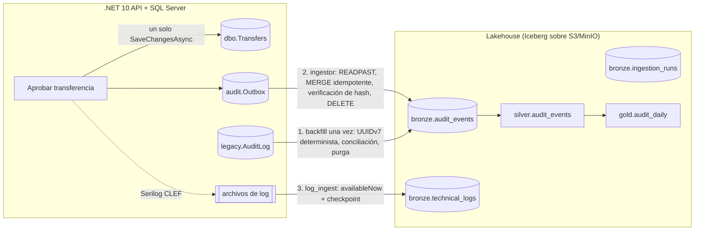

# AuditLake

Prueba de concepto para sacar la auditoría y los hiper-logs de un core .NET 10 / SQL Server hacia un
Lakehouse (PySpark + Apache Iceberg + dbt, con catálogo compatible con AWS Glue), dockerizada en local.

## 1. Cómo levantar el entorno

**Requisitos:** Docker Desktop (o Docker Engine con Compose v2) con ~8 GB de memoria asignada (probado con 7,6 GiB), y Git. Para las
pruebas .NET, el SDK de .NET 10.

**Demo de punta a punta** (un solo comando, en un proyecto de Compose aislado):

```bash
git clone https://github.com/JuanJosec202/auditlake.git && cd auditlake
cp .env.example .env
docker compose -p auditlake-demo run --build --rm spark python -m auditlake.demo
```

`-p auditlake-demo` crea un proyecto aislado: contenedores, red y volúmenes propios (`auditlake-demo_*`). El
Compose base no publica puertos, así que puede correr junto al stack de desarrollo sin mezclar datos. Para
borrar la demo: `docker compose -p auditlake-demo down -v`.

La demo siembra 36.800 eventos históricos en `legacy.AuditLog`, aprueba 200 transferencias por la API, ejecuta
el ingestor, el backfill dos veces (idempotencia), la conciliación y purga del histórico, `log_ingest`,
`dbt build`, compactación, retención y una conciliación final, e imprime un resumen con cifras y tiempos.
Verificada desde un clon limpio en Windows 11 Pro con Docker Desktop 27.0.3 (16 CPU y 7,6 GiB asignados;
host i7-1360P, 15,7 GB de RAM): 786 s en frío, de los cuales 166 s son la demo y ~620 s la primera descarga,
construcción (incluida la compilación de MinIO) y arranque; 257 s en caliente con el stack de desarrollo
encendido. El Compose base no publica puertos, así que la demo y el desarrollo conviven con datos separados.

**Desarrollo** (con puertos: API 8080, SQL Server 14333, catálogo 8181):

```bash
docker compose -f docker-compose.yml -f docker-compose.dev.yml up -d
docker compose -f docker-compose.yml -f docker-compose.dev.yml run --rm spark python -m auditlake.main
```

Para no repetir `-f`, `.env.example` incluye comentadas `COMPOSE_FILE` y `COMPOSE_PATH_SEPARATOR`.

**Pruebas** (en el mismo proyecto aislado de la demo, después de correrla; nunca contra el proyecto de
desarrollo, porque las pruebas aplican retención y expiran snapshots):

```bash
docker compose -p auditlake-demo run --rm spark sh -c "ruff check . && pytest -q"
docker compose -p auditlake-demo run --rm spark sh -c "cd /dbt && dbt build --profiles-dir /dbt"
dotnet test
```

pytest corre 29 pruebas (classify, caída tras el commit Iceberg, cuarentena, 101/102, ingestor único, poda,
backfill, mantenimiento, huérfanos, v2), `dbt build` 10 nodos y `dotnet test` las 2 pruebas de atomicidad de la
outbox con Testcontainers. No hay `make chaos`: cada caída se prueba por separado (ver sección 6).

**Benchmark:** `pipelines/benchmarks/run.sh setup|baseline|sql|iceberg|legacy-table|rcsi …` en el proyecto
aislado `auditlake-bench` con los límites de `docker-compose.bench.yml`.

## 2. Arquitectura



1. **Histórico (una vez):** `legacy.AuditLog` → `main --backfill` → `bronze.audit_events` → conciliación por
   (event_id, payload_hash) → purga en SQL por lotes, solo de lo verificado.
2. **Auditoría obligatoria (cero pérdida):** negocio + `audit.Outbox` en la misma transacción → job PySpark →
   MERGE idempotente → verificación de hash → DELETE en la outbox.
3. **Hiper-logs (best effort):** Serilog JSON a archivos → `log_ingest` → `bronze.technical_logs`. Nunca pasan
   por SQL Server.

Catálogo: Iceberg REST en local, Glue Data Catalog en AWS. Capa analítica: dbt (`dbt-spark`, `method: session`)
con silver y gold como vistas.

## 3. Decisiones y trade-offs

| Decisión | Alternativa descartada | Motivo |
|---|---|---|
| Outbox transaccional | CDC (Debezium) | La app conoce el significado de negocio; CDC captura filas |
| Outbox transaccional | Buffer asíncrono en memoria | Pierde eventos si el proceso cae |
| Sin broker | Kafka | Un productor y un consumidor; la outbox ya da durabilidad |
| Outbox sin columna de estado | Estado pending/confirmed | Un INSERT y un DELETE por evento |
| Hiper-logs fuera de SQL | Hiper-logs por la outbox | Trasladaría el problema original al nuevo diseño |
| Un escritor por tabla (`sp_getapplock`) | Workers en paralelo | El worker no tiene estado; RPO 0, RTO = reinicio + drenaje |
| `WITH (READPAST)` con RCSI OFF | Activar RCSI | Medido: 0 esperas por bloqueo en las 4 variantes; RCSI no aportó (sección 6) |
| MinIO + Iceberg REST local | Glue Catalog en Docker | Glue Catalog no existe fuera de AWS. MinIO se compila desde el tag `RELEASE.2025-10-15T17-29-55Z` porque ya no publica imágenes; en AWS se usa S3 |
| UUIDv7 determinista en el backfill | UUIDv5 | La búsqueda por rango de event_id depende del orden temporal |
| `dbt-spark` `method: session` | Spark Thrift Server | Un contenedor menos |
| Partición `days(occurred_at)` | Partición por event_type | Las consultas filtran por fecha (ver sección 5 sobre `months`) |
| Silver/gold como vistas | Incremental | Solo si una medición lo justifica |

**Fuera de alcance:** Kafka, Debezium/CDC, Airflow, MediatR/CQRS, repositorio genérico sobre EF, varios proyectos
.NET por capa, Lake Formation local, buffer en memoria, gold incremental, imagen de Glue en el Compose, Makefile.

## 4. Diseño del Lakehouse

- **bronze.audit_events:** Iceberg v2, partición oculta `days(occurred_at)`, orden de escritura
  `event_type, occurred_at`, payload como texto JSON + `schema_version` + `payload_hash`, métricas `full` para
  `event_id`.
- **Búsqueda de existencia:** por rango [min, max] de event_id del lote + semi-join, sin filtrar por fecha (un
  evento archivado que llega con otra fecha es conflicto, no duplicado). Iceberg poda por los límites de la
  columna: 1 de 13 archivos en la prueba; tras el backfill, 9 de 262 y 2 de 194 después de compactar. La poda por
  `occurred_at` solo se usa en el MERGE de los eventos confirmados como nuevos.
- **Cuarentena:** mismo event_id con otro hash → `DELETE … OUTPUT (columnas explícitas) … INTO
  audit.OutboxQuarantine` en la misma transacción del DELETE verificado; bronze no se toca.
- **Backfill:** UUIDv7 con los ms de `occurred_at` y el resto de SHA-256 de `sqlserver:AuditLake/legacy.AuditLog/<Id>`.
  Una fila con discrepancia queda en SQL para revisión humana.
- **Silver y gold:** silver normaliza TransferApproved v1 y v2; gold agrupa por día, tipo de evento y moneda, con
  el total en NULL cuando la moneda es desconocida (v1).
- **Mantenimiento** (procedimientos de Iceberg, con el lock de la tabla): `rewrite_data_files` (262 → 192
  archivos, máximo por partición 25 → 1, pares (event_id, payload_hash) idénticos), `rewrite_manifests` solo sobre
  un umbral (10 manifests ≤ 50: omitido), retención configurable con bloqueo legal (audit_events 365 días en la
  demo, technical_logs 30) + `expire_snapshots`, y `remove_orphan_files` con `file_list_view` (listado por
  S3FileIO, porque el Hadoop 3.3.4 de la imagen no lista `s3://`).
- **Particionamiento:** tras compactar, 1 archivo de ~477 KB por día para ~5.435 eventos diarios. A este volumen
  `months` daría archivos de ~14–15 MB y 12 veces menos particiones; `days` se justifica desde el orden de
  1 millón de eventos por día. La demo mantiene `days`.

## 5. Resiliencia y modos de falla

| Falla | Comportamiento | Evidencia |
|---|---|---|
| Caída tras el commit Iceberg, antes del DELETE | La fila sigue pendiente; el reintento la reconoce como duplicado y la borra | 1 fila en Iceberg, 0 pendientes, `duplicates=1, deleted=1` |
| Antes de leer / a mitad del MERGE | Cubiertas por atomicidad: antes de leer no hay escrituras; el MERGE publica un snapshot en un solo commit | No probado (documentado) |
| MinIO caído | La corrida falla, las filas quedan pendientes, el reintento archiva sin duplicados | Detectado en 24 s; 5 pendientes; `inserted=5, deleted=5`; 0 duplicados |
| Dos ingestores a la vez | El segundo no obtiene `sp_getapplock` y sale antes de leer | `status='skipped'` |
| Transacción de la API abierta (101/102) | READPAST la salta y la toma en la pasada siguiente | Ambos eventos archivados una vez; sin READPAST, bloqueo de 5 s |
| Mismo event_id, distinto hash | Cuarentena; el resto del lote avanza | Fila completa en cuarentena; original intacto en Iceberg |
| Commit con estado desconocido (catálogo local) | Falla sin borrar de SQL; el reintento no duplica | 0 event_id duplicados en 1,08 M de filas |
| Ingestor colgado | Conserva el lock mientras su sesión SQL siga abierta | Local: detener el contenedor; AWS: timeout del Glue Job; alerta por edad del pendiente más antiguo |

**Limitaciones del entorno local:** la lectura vectorizada de Iceberg está desactivada porque con ~1M de filas
tumbaba la JVM de Spark (SIGSEGV en Java 11 y 17), y el catálogo local sobre SQLite devuelve 500 en algunos
commits concurrentes. En AWS se usan el runtime de Glue y Glue Data Catalog.

## 6. Pruebas de aceptación con mediciones reales

Benchmark: 1.000.040 eventos históricos, 5 corridas de 5.000 aprobaciones, concurrencia 8, 0 errores; límites
por servicio: sqlserver 2 CPU / 2,5 GiB, api 2 CPU / 512 MiB, spark 2 CPU / 3 GiB por contenedor.

| # | Prueba | Resultado |
|---|---|---|
| 1 | Cero pérdida tras caída | Reintento con `duplicates=1, deleted=1`; 0 pendientes; 0 duplicados en bronze |
| 2 | Orden de commit 101/102 | Ambos archivados una vez, con RCSI OFF y en las 3 variantes con RCSI ON |
| 3 | Sin bloqueo con el ingestor apagado | 20.000 aprobaciones con el ingestor detenido, 0 errores; la outbox llegó a 20.500 filas (10.264 KB). El drenaje posterior se prueba con MinIO caído: 5 pendientes → 0 tras el reintento |
| 4 | p95 tabla SQL vs outbox | 30,1 ms vs 28,6 ms (sin diferencia a esta escala) |
| 5 | Costo | SQL 141.648 KB vs Parquet 85,7 MiB (~1,6x); costo en la tabla de abajo |
| 6 | Compactación | 262 → 192 archivos; máximo por partición 25 → 1 |
| 7 | Esquema v1 y v2 | Silver normaliza ambos; build con advertencia ante un payload malformado |
| 8 | Caídas | Tras commit Iceberg, MinIO caído y dos workers, cada una por separado (sin `make chaos`) |

**Rendimiento del core bajo carga analítica**

| Escenario | p50 | p95 |
|---|---|---|
| Sin consulta histórica | 15,1 ms | 28,6 ms |
| Histórico consultado en SQL Server | 15,9 ms | **283,6 ms** |
| Histórico en Iceberg + ingestor activo | 18,6 ms | **38,7 ms** |
| Auditoría en tabla SQL en vez de outbox | 16,5 ms | 30,1 ms |

SQL e Iceberg devolvieron los mismos totales en los 184 días. La consulta en sí es más rápida en SQL a esta escala
(p50 545 ms frente a 4,0 s en Spark, y 25 s la primera por el arranque de Spark): el beneficio medido es que la
analítica deja de competir con el core.

**RCSI** (ingestor activo)

| Variante | Consulta del worker | p95 | Esperas LCK_M | 101/102 |
|---|---|---|---|---|
| RCSI OFF | `WITH (READPAST)` | 23,1 ms | 0 | ok |
| RCSI ON | `WITH (READPAST)` (compatibilidad) | 37,7 ms | 0 | ok |
| RCSI ON | `WITH (READCOMMITTEDLOCK, READPAST)` | 31,3 ms | 0 | ok |
| RCSI ON | sin hint | 30,5 ms | 0 | ok |

Decisión: RCSI OFF. EF Core lo activa al crear la base; la migración `RcsiOffBaseline` fija la línea base.

**Costo** (estimación; tarifas us-east-1 de la AWS Price List API consultadas el 26-11-2026)

| Concepto | Por millón de eventos retenidos, por mes |
|---|---|
| Almacenamiento en RDS for SQL Server (gp3 Single-AZ / Multi-AZ + backup) | 0,016 / 0,044 USD |
| Almacenamiento en S3 (bronze) | 0,002 USD |
| Glue Catalog | 0 USD (capa gratuita) |
| Athena (100 escaneos completos de ese millón) | 0,045 USD |

| Job de Glue (2 DPU, mínimo 1 min) | USD/mes | Outbox pico con 1 M eventos/día | Equilibrio solo por almacenamiento |
|---|---|---|---|
| Cada 5 min | 126,72 | ~3.500 eventos, ~1,7 MB | ~3.000 M de eventos retenidos |
| Cada 15 min | 42,24 | ~10.400 eventos, ~5,1 MB | ~1.000 M |
| Cada 60 min | 10,56 | ~41.700 eventos, ~20,4 MB | ~250 M |

El almacenamiento solo compensa el costo fijo del job a volúmenes altos; la frecuencia se elige por frescura y
tamaño de outbox. El detalle de tarifas, fuentes y supuestos está en `docs/design.md` (sección 9).

## 7. Respuestas a las cuatro preguntas

**1. ¿Cuándo se vuelve problemático conservar y consultar el histórico en SQL Server y con qué métrica se mide el costo-beneficio de moverlo a Iceberg?**
Se vuelve problemático cuando el histórico se consulta en la misma instancia que atiende al core y cuando crece
sin límite: son datos append-only que casi no se leen, pero compiten con el negocio por buffer pool, IO, log de
transacciones, backups y licencias por núcleo. La métrica principal es el p95 del core mientras corre la
consulta histórica: con 1.000.040 eventos, aprobar una transferencia pasó de 28,6 ms (sin consulta) a 283,6 ms
con la consulta en SQL, y se quedó en 38,7 ms con el histórico en Iceberg y el ingestor activo (mismos totales en
ambos motores). La métrica secundaria es el costo por millón de eventos retenidos, que es una estimación con
tarifas de AWS: 0,016–0,044 USD/mes en RDS for SQL Server frente a 0,002 USD/mes en S3, con una compresión medida
de ~1,6x. El costo fijo del job de Glue (10,56–126,72 USD/mes según la frecuencia) solo se compensa por
almacenamiento a volúmenes altos; el beneficio principal es el del core.

**2. ¿Qué responsabilidad tiene PySpark, cuál tiene dbt y cómo ayuda Glue Data Catalog a gobernar los datos sin rehacer el modelo?**
PySpark mueve los datos y garantiza la entrega: lee la outbox con READPAST, hace un MERGE idempotente, verifica
el hash antes de borrar, pone en cuarentena los conflictos, hace el backfill con conciliación y mantiene las
tablas (compactación, retención, huérfanos). dbt define el significado y la calidad: normaliza v1 y v2 en
silver, arma gold y prueba unicidad, obligatoriedad y la conciliación `read_count = inserted + duplicates +
conflicts` y `conflicts = quarantined`. Glue Data Catalog es el registro único de las tablas Iceberg que leen
Athena, EMR y Redshift: el mismo código cambia de catálogo con la configuración (`conf/local` usa Iceberg REST;
`conf/aws` usa GlueCatalog), y los permisos de Lake Formation se aplicarían sobre esas tablas sin rehacer el
modelo. En esta PoC Glue Data Catalog está configurado como referencia, no ejecutado (sección 10).

**3. ¿Qué ocurre si la ingesta cae durante un pico y cómo se recuperan los eventos pendientes?**
El core sigue operando: cada aprobación confirma el cambio de negocio y su fila en `audit.Outbox` con el mismo
`SaveChangesAsync`, y si la outbox no se puede escribir la aprobación se revierte (prueba con un CHECK real).
Mientras la ingesta está caída la outbox crece: con el ingestor detenido, 20.000 aprobaciones terminaron sin
errores y la outbox llegó a 20.500 filas (10.264 KB, ~0,48 GiB por millón de eventos pendientes). La garantía
cubre los eventos confirmados mientras SQL Server tenga capacidad para persistirlos; si se queda sin espacio,
falla la operación de negocio, por eso se alerta por la edad del pendiente más antiguo y el espacio libre. Al
volver, el ingestor drena por lotes de 1.000 en orden de Id, inserta solo lo nuevo y borra de SQL únicamente lo
verificado en Iceberg: tras una caída entre el commit Iceberg y el DELETE, el reintento dio
`duplicates=1, deleted=1`; con MinIO caído la falla se detectó en 24 s, las 5 filas siguieron pendientes y el
reintento las archivó sin duplicados. Los hiper-logs son best effort: sus archivos esperan en disco y el
checkpoint evita releerlos, pero un archivo perdido no se recupera.

**4. ¿Qué sugerencia de IA se corrigió, quién tomó la decisión y qué evidencia demuestra el resultado?**
Caso principal (entrada 14 de `docs/ai-log.md`): ChatGPT sugirió dos veces generar el `event_id` del histórico
como UUIDv5 a partir de sistema, tabla y PK. Un UUIDv5 no tiene orden temporal y rompería la búsqueda por rango
de `event_id` que poda archivos. La decisión fue mía, con esta instrucción de corrección: «No pidas UUIDv5: el
plan ya hace lo correcto». El plan mantuvo un UUIDv7 determinista, con los ms de `occurred_at` y el resto derivado
de SHA-256 de sistema, tabla y PK (`legacy_event_id` en
[`pipelines/auditlake/classify.py`](pipelines/auditlake/classify.py)). Evidencia (commit `9a3c011`):
- Replay: repetir el backfill del mismo rango da `inserted=0, duplicates=36800`
  ([`test_backfill_same_range_twice_then_purge_only_verified`](pipelines/tests/test_maintenance.py) y la demo).
- Poda: tras el backfill, un lote normal escanea 9 de 262 archivos, y 2 de 194 tras compactar
  ([`docs/design.md`](docs/design.md), secciones 4 y 9;
  [`test_event_id_lookup_skips_files_of_other_days`](pipelines/tests/test_ingest.py)).
- Identidad: [`test_legacy_identity.py`](pipelines/tests/test_legacy_identity.py) verifica que el ID es
  determinista, versión 7 y ordenado por `occurred_at`.

Segundo caso (entrada 3): el plan de Claude Code para la Fase 1 incluía `ITransferRepository` e `IUnitOfWork`
sobre EF Core. Lo rechacé por sobreingeniería: el `DbContext` ya es unidad de trabajo, así que el caso de uso lo
usa directamente y la serialización y el hash viven solo en `OutboxMessage.Create`. Evidencia: commits
`1f7b352` y `b40a390`, y la prueba de atomicidad en la que un CHECK real revierte la aprobación
([`ApproveTransferAtomicityTests.cs`](tests/AuditLake.Api.Tests/ApproveTransferAtomicityTests.cs)).

## 8. Uso de IA

Resumen de [`docs/ai-log.md`](docs/ai-log.md), que tiene las 18 entradas con su evidencia.

| Asistente | Rol | Cómo lo controlé |
|---|---|---|
| Claude (chat) | Revisor de arquitectura: evaluar la propuesta, revisar cada plan y cada resultado de Claude Code | Sus sugerencias también se revisaron; varias se descartaron (entradas 6 y 14) |
| Claude Code | Implementación por fases en el repositorio | `CLAUDE.md` con alcance congelado, plan obligatorio antes de cada fase, salida real de pruebas como condición de cierre |
| ChatGPT | Contraste de los mensajes de aprobación, segunda opinión técnica y consulta de documentación oficial | Lo que aportó se validó contra la documentación y contra pruebas |

Reglas desde el inicio: alcance congelado en `CLAUDE.md`, ninguna fase sin plan aprobado ni cierre sin la salida
real de las pruebas, y ningún "debería funcionar" sin ejecutarlo.

**Decisiones clave**
- Revisión de la propuesta inicial: la IA señaló huecos (hiper-logs sin ruta, tres escrituras por evento, MERGE
  sin poda, Glue Catalog fuera de Docker) y el alcance se congeló (entrada 1).
- Correcciones humanas a propuestas de la IA: pasar a .NET 10 en lugar de compilar net8.0 con el SDK 9 (2), usar
  el DbContext directamente en vez de repositorio y unidad de trabajo (3), buscar el event_id sin filtrar por
  fecha en vez de depender de una invariante (6), UUIDv7 determinista en vez de UUIDv5 (14), probar
  `file_list_view` antes de agregar JARs (15) y medir el p95 del core en lugar de solo la latencia de la consulta
  (16).
- Aciertos de la IA: catálogo REST persistente con prueba de reinicio (4), READPAST para el caso 101/102 (7),
  causa de los 346 s con MinIO caído (10), rango min/max en lugar de `IN` para podar (6).
- Hallazgos que cambiaron conclusiones: RCSI activado por EF Core (8), montos de monedas distintas sumados en
  gold (11), fallos que solo aparecieron con 1 millón de filas y en un clon limpio (17).
- Un error de diseño propio, detectado en revisión: detener la corrida ante un conflicto habría bloqueado el
  drenaje de la outbox (5).

**Balance** (de la bitácora): la IA aceleró el scaffolding de cada fase, la configuración de Spark, Iceberg y
MinIO, las pruebas de integración, la causa raíz de fallos de infraestructura y detalles no obvios (el límite de
200 valores en `IN`, READPAST, `file_list_view`). El criterio humano fue necesario en el alcance y los recortes
de sobreingeniería, la identidad de los eventos, la corrección de datos, la decisión de medir antes de activar
RCSI y la elección de qué medir para demostrar valor de negocio.

## 9. Despliegue en AWS

El mismo código está preparado para AWS cambiando solo la configuración; la referencia está en
[`conf/aws`](conf/aws/README.md) y **no se ejecutó en una cuenta de AWS**:
- **Job PySpark** en **AWS Glue 5.0** (Spark 3.5.4, Iceberg 1.7.1, la misma combinación validada en Docker):
  `conf/aws/glue-job.json` define el job con `MaxConcurrentRuns=1`, timeout, 2 workers G.1X, la conexión a SQL
  Server y las propiedades de Iceberg; `conf/aws/glue_entry.py` es el script de entrada que traslada los
  parámetros del job a las variables que lee `auditlake/config.py` (sintaxis validada, sin ejecutar en Glue), y
  `conf/aws/README.md` describe los pasos. El `sp_getapplock` por tabla sigue coordinando los escritores.
- **Catálogo y almacenamiento:** Glue Data Catalog (`GlueCatalog`) y S3 en lugar de Iceberg REST y MinIO
  (`conf/aws/spark-defaults.conf`).
- **dbt** con el adaptador dbt-glue, ejecutado desde un contenedor (ECS o CodeBuild) disparado por EventBridge
  después del job de ingesta; los modelos siguen en Spark SQL. Las vistas Spark registradas en Glue no se
  consultan desde Athena: si negocio necesita gold desde Athena, se materializa o se adapta a dbt-athena.

| Validado en Docker | Sin ejecutar en AWS |
|---|---|
| Job PySpark completo, dbt, mantenimiento, demo y pruebas (secciones 2 y 7) | Glue Job, trigger, conexión, rol y secreto |
| Catálogo Iceberg REST + S3 compatible (MinIO) con `S3FileIO` | GlueCatalog contra Glue Data Catalog y S3 reales |
| Driver JDBC, `sp_getapplock` y READPAST contra SQL Server 2022 | Red Glue → SQL Server; dbt-glue; rutas de `log_ingest` en S3 |

Versiones verificadas en Docker: .NET 10.0.404 / EF Core 10.0.15, SQL Server 2022 CU20, Spark 3.5.4 (Python
3.8.10), Iceberg 1.7.1 (cliente) y REST fixture 1.8.1, dbt-core 1.8.7 con dbt-spark 1.8.0.
